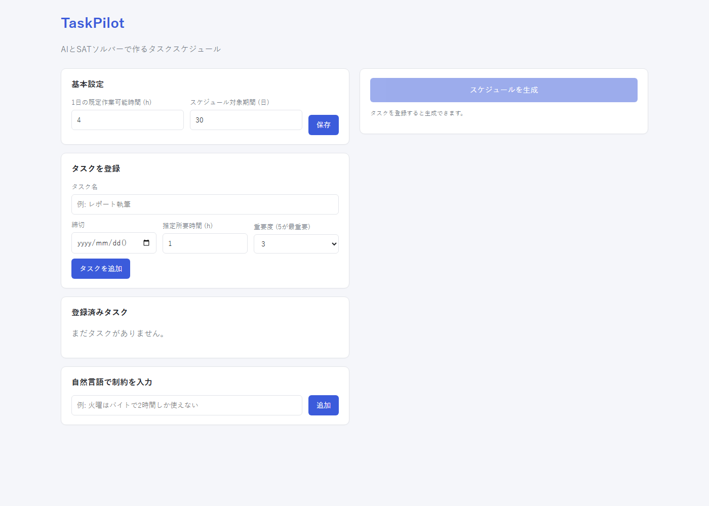
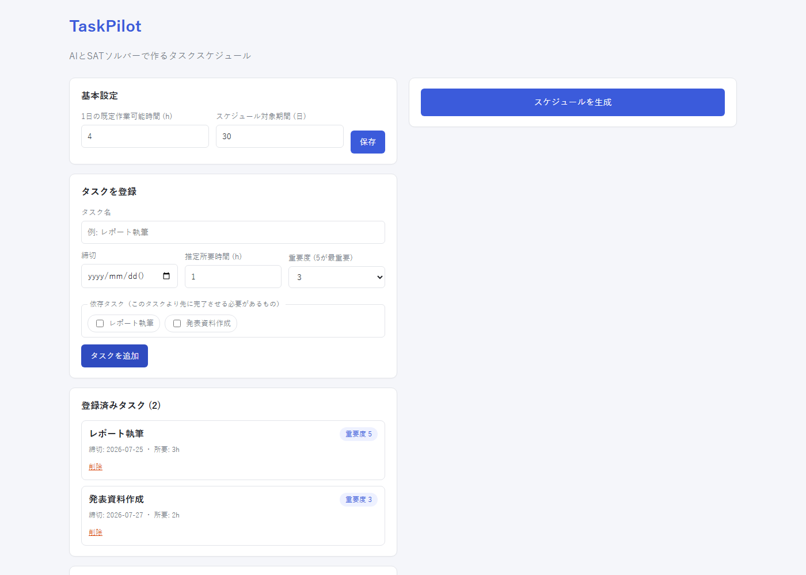
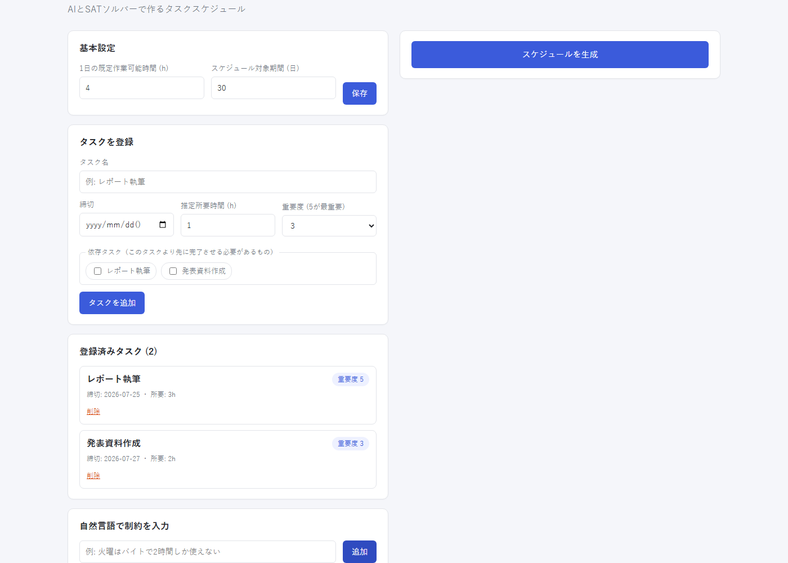
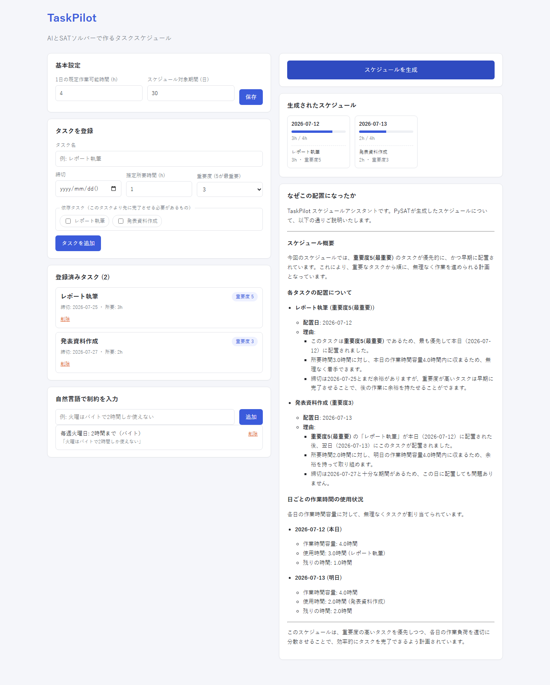
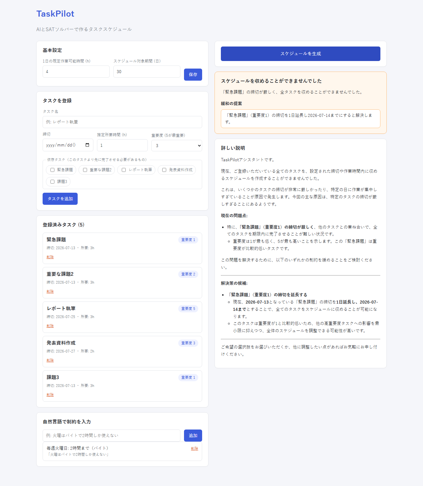

# TaskPilot

課題やタスクの締切・所要時間・重要度・依存関係と、「この日は作業できない」といった予定の条件をもとに、締切を必ず守る作業日程を自動で組むWebアプリです。予定の条件は日本語の文章で入力でき、AI（Gemini）が読み取ってスケジュールの制約に変換します。

大学の授業（知能情報システム）のレポート課題として開発しました。

## 主な機能

- タスク登録：締切・所要時間・重要度・依存関係（「Aが終わってからB」）を設定
- 自然言語での条件入力：「毎週水曜はバイトで1時間しか使えない」のような文章を、Geminiが曜日・日付・作業可能時間などの構造化データに変換
- スケジュール生成：SATソルバーで、締切・依存関係・1日の作業可能時間を必ず守る日程を作成し、重要度の高いタスクほど早い日に置くよう最適化
- 組めない場合の提案：条件が厳しすぎて日程が組めないときは、どの条件をゆるめれば解決するか（作業時間の上限を戻す、締切を延ばすなど）を提示
- AIによる説明：作成した日程の意図や、組めなかった理由をGeminiがわかりやすく説明

## 技術スタック

| 区分 | 使用技術 |
| --- | --- |
| フロントエンド | React 19 / TypeScript / Vite |
| バックエンド | Python / FastAPI / Pydantic |
| スケジューリング | PySAT（Glucose3、MaxSAT：RC2） |
| AI | Google Gemini API（google-genai） |
| データベース | SQLite |

## スケジューリングの考え方

- 各タスクは、締切までのいずれか1日に割り当てる
- 依存タスクは、依存元より後の日に割り当てる
- 各日の合計所要時間は、その日の作業可能時間を超えない（重み付きの制約をCNFに変換）
- 上の条件を必ず守ったうえで、重要度の高いタスクほど早い日に置くようMaxSATで最適化する
- 日程が組めない場合は、制約を1つずつゆるめて試し、解決につながる変更を提案する

## 画面

| 初期画面 | タスク登録 | 条件の入力 |
| --- | --- | --- |
|  |  |  |

| スケジュール | 組めない場合の提案 |
| --- | --- |
|  |  |

## 起動方法

### バックエンド

```bash
cd backend
pip install -r requirements.txt
cp .env.example .env   # GEMINI_API_KEY を設定
uvicorn app.main:app --reload
```

### フロントエンド

```bash
cd frontend
npm install
npm run dev
```

ブラウザで http://localhost:5173 を開きます。
